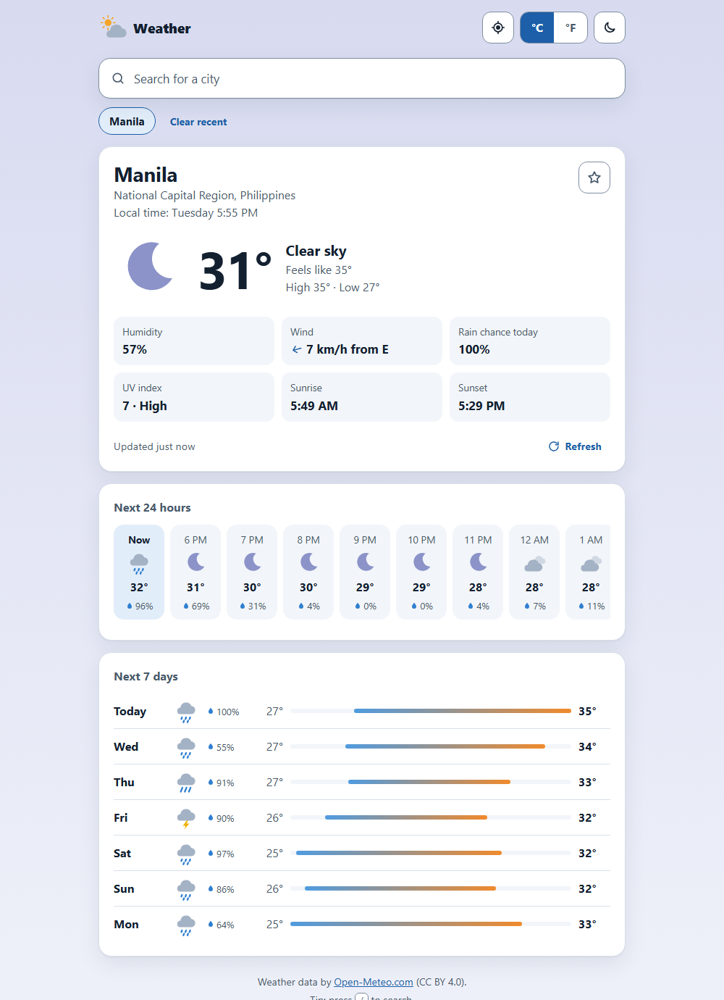
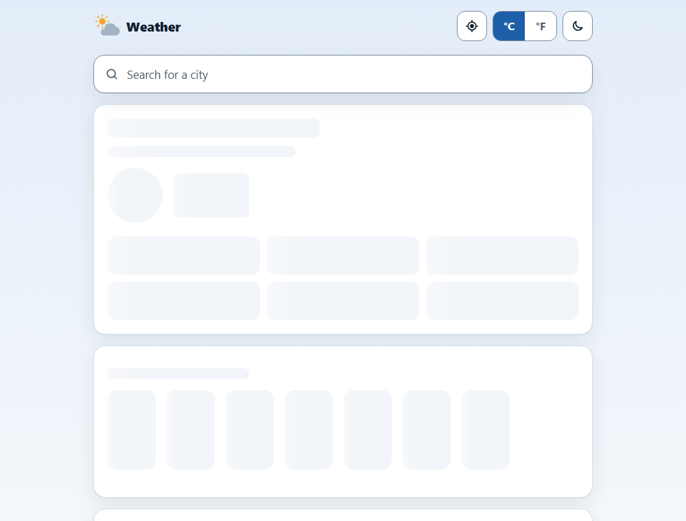
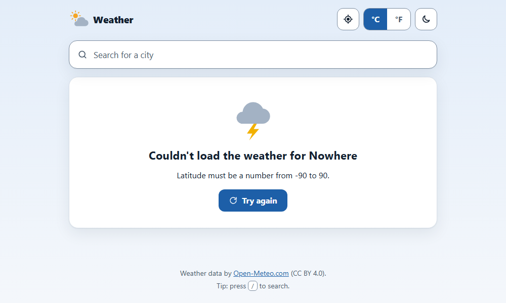
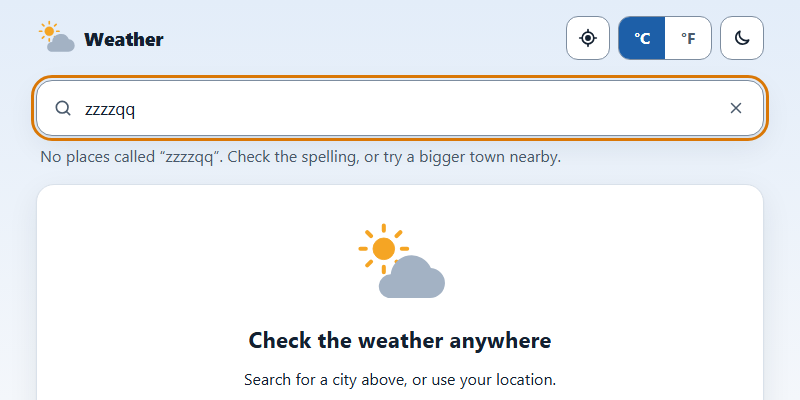
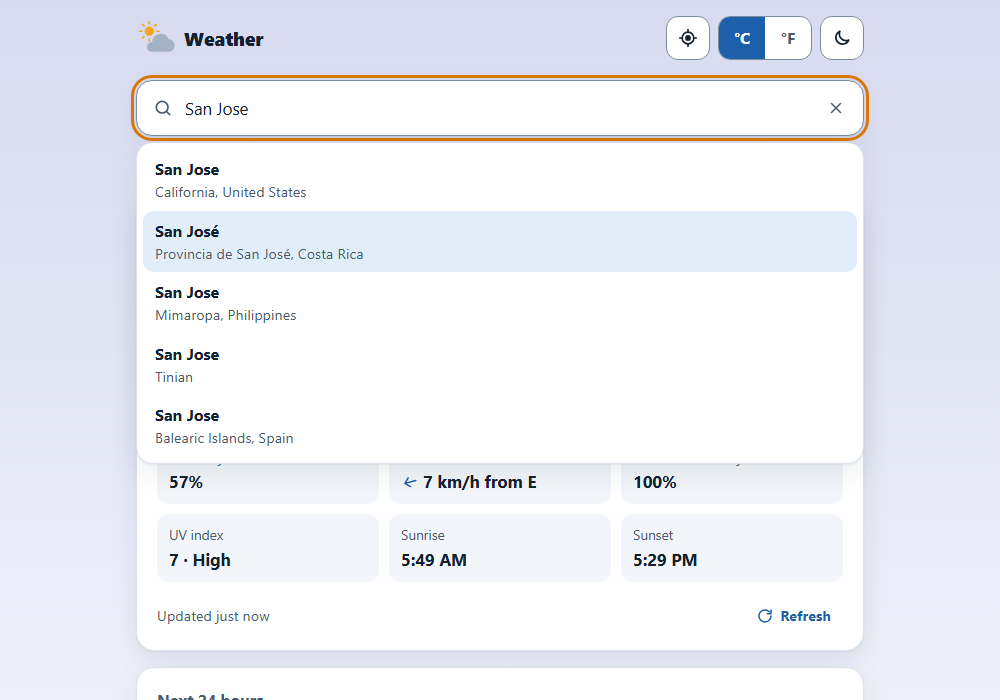
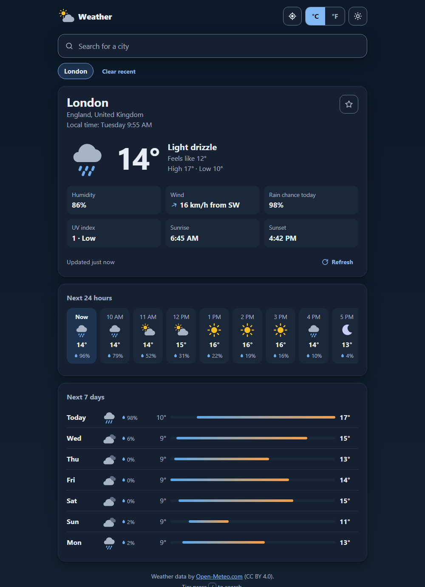
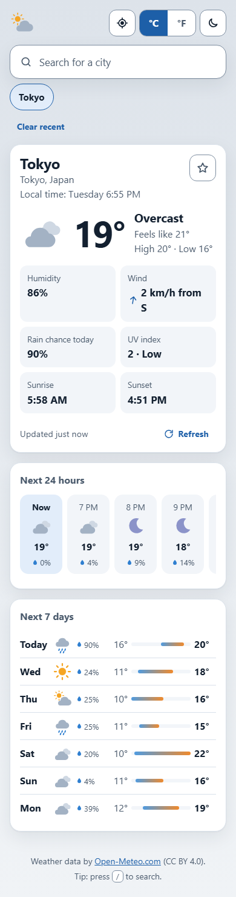

# weather_app

A weather website. Type a city. You see the weather now, the next 24 hours and the next 7 days.

The weather data comes from [Open-Meteo](https://open-meteo.com/). Open-Meteo is free. You do not need a key.

## What it can do

- **Search** for a city. Use the arrow keys and Enter, or click a place.
- **Use my location** (📍 button). The browser asks you first.
- See the weather **now**: temperature, "feels like", humidity, wind, rain chance, UV, sunrise and sunset.
- See the **next 24 hours**. Swipe or scroll the row.
- See the **next 7 days**. The bar shows the lowest and the highest temperature.
- Change **°C / °F**. The app remembers your choice.
- **Favourites** (★) and **recent** cities. Click one to open it again.
- **Light and dark** mode.
- The background colour changes with the weather (sun, night, clouds, rain, snow, storm).
- Press <kbd>/</kbd> to jump to the search box.

## Waiting and errors

The app always tells you what is happening.

| What happens | What you see |
|---|---|
| First visit | A welcome card with example cities |
| Loading | Grey boxes in the shape of the weather cards |
| Searching | A small spinner in the search box |
| No city found | "No places called …" |
| The server is slow or down | A message and a **Try again** button |
| No internet | "You're offline" at the top |
| Location is blocked | A message: you can still search |

| Loading | Error | No city found |
|---|---|---|
|  |  |  |

| Search | Dark mode | Phone |
|---|---|---|
|  |  |  |

## How it works

1. The browser (`app.js`) asks **our** server: `/api/search` or `/api/weather`.
2. Our server (Flask) asks **Open-Meteo** with `requests`.
3. Our server checks the answer and makes it small and clean.
4. The browser draws the weather.

## Tools, languages and platforms

| Name | What it is | What we use it for |
|---|---|---|
| Python | A programming language | The server code |
| Flask | A Python web framework | The web page and our API |
| requests | A Python library | HTTP calls to Open-Meteo |
| pytest | A Python test tool | The tests |
| HTML, CSS | Web page languages | The page and its look |
| JavaScript | The language of the browser | `fetch()`, search, loading and error states |
| JSON | A data format | The data between the server and the browser |
| Open-Meteo | A free weather API | The weather data and the city search |
| Render | A hosting platform | Putting the website online |
| GitHub | A code platform | Saving the code, pull requests |

## How to start it

1. Make a virtual environment:
   `python -m venv .venv`
2. Install the tools:
   `.venv\Scripts\python -m pip install -r requirements.txt`
3. Start the app:
   `.venv\Scripts\flask --app weather run --debug --port 5001`
4. Open http://127.0.0.1:5001 in your browser.

## How to test it

`.venv\Scripts\python -m pytest`

The tests do not use the internet. They use saved Open-Meteo answers in `tests/fixtures/`.

## The API

| Address | What it gives you |
|---|---|
| `/api/search?q=Manila` | Places with this name |
| `/api/weather?lat=14.6&lon=121` | Weather now, the next 24 hours and the next 7 days |
| `/api/weather?lat=14.6&lon=121&units=imperial` | The same, in °F, mph and inches |

When something is wrong, the API says so:

| Code | Meaning |
|---|---|
| 400 | Your input is wrong (for example, a latitude of 95) |
| 502 | Open-Meteo has a problem |
| 504 | Open-Meteo is too slow |

## Put it online (Render)

The file `render.yaml` tells Render what to do. On Render, choose **New → Blueprint** and pick this repository. Every merge into `main` updates the website.
